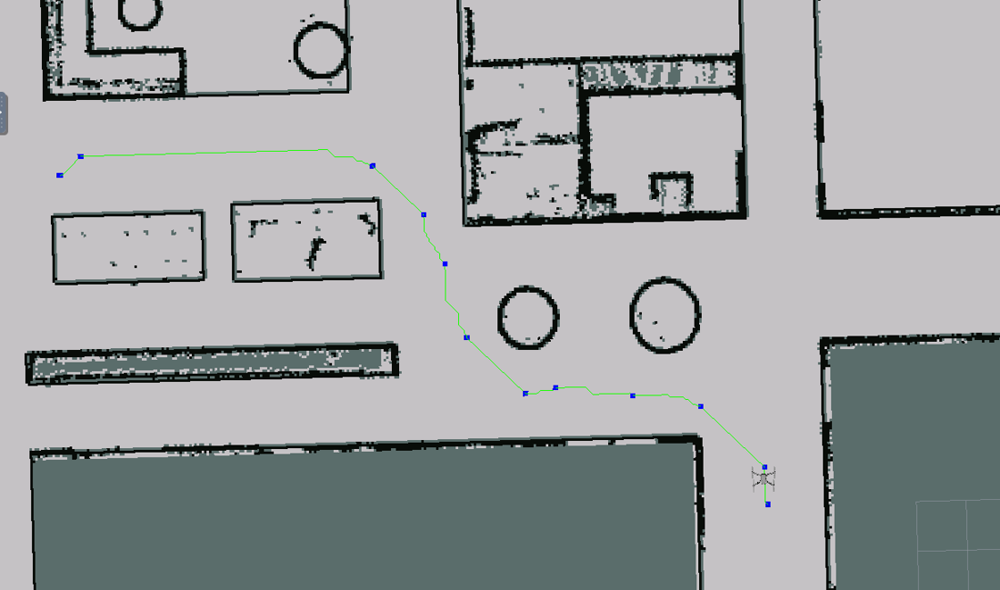
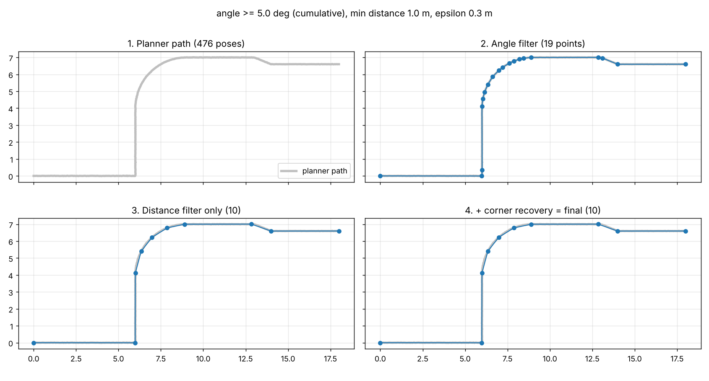
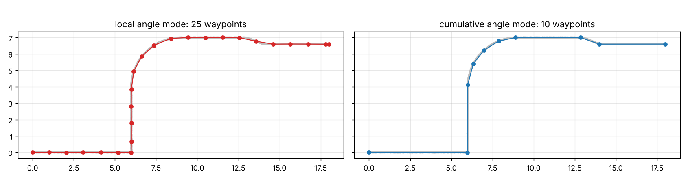
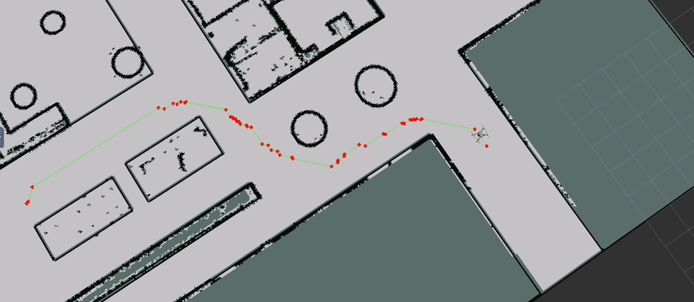
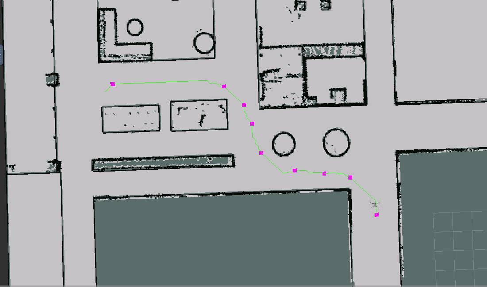

# Waypoint Reduction for ROS Navigation

Global planners such as `move_base`/navfn return paths with hundreds of poses spaced a few centimetres apart. That is too many to send to a drone or a waypoint follower. This package reduces such a path to a **small set of waypoints that keeps the shape of the path**: corners stay sharp, straight sections collapse to their endpoints, and small detours are not lost.

<p align="center"><br/><sub>RViz: dense planner path (green) reduced to a handful of waypoints (blue)</sub></p>

## Algorithm

```
dense path ─► 1. angle filter ─► 2. distance filter ─► 3. corner recovery ─► waypoints
```

1. **Angle filter.** This keeps only the points where the path turns by at least `angle_threshold_deg`, so points along straight sections are dropped.
   - In the default `cumulative` mode, the turn is measured between the direction since the last kept point and the direction over the next `lookahead` metres. This picks up gentle arcs and ignores the millimetre-level jitter of planner paths.
   - When a turn is detected, the point kept is the one furthest from the local chord, which is the actual corner, not the first point that noticed the turn.
2. **Distance filter.** This enforces a minimum spacing `min_distance` between consecutive waypoints, and remembers the points it rejects.
3. **Corner recovery.** Step 2 can throw away a real corner. So before accepting each new waypoint, the algorithm looks at the points rejected since the last one. If any of them is at least `epsilon` metres from the straight line between the two waypoints, the furthest one is put back. This is the key idea of Douglas–Peucker, applied only where the distance filter removed something.

The start and the goal are always kept. Every waypoint is oriented to face the next one, and the last waypoint keeps the requested goal orientation.



### Why the cumulative angle mode exists

The 2023 version measured the angle at each point using only its immediate neighbours (`local` mode, still available). On real planner output, a few millimetres of grid jitter make neighbouring segments differ by more than 5°, so almost every point passes the angle filter. Measuring over a longer distance removes that noise:



## Try it without ROS

```bash
pip install -r python/requirements.txt
python python/demo.py --angle 5 --min-distance 1.0 --epsilon 0.3
```

The demo runs on a synthetic noisy planner path and saves the figures above. `python/waypoint_reducer.py` is a pure-Python copy of the C++ core, and its output has been checked to match the C++ waypoint for waypoint.

## Use with ROS 1

```bash
cd ~/catkin_ws/src && git clone https://github.com/vishrutsingh1/waypoint-reduction-ros.git
cd .. && catkin_make && source devel/setup.bash
roslaunch waypoint_navigation waypoint.launch planner_service:=/move_base/make_plan
```

Call `~waypoints` (`nav_msgs/GetPlan`) with a start and a goal. The node asks the planner for the dense path and returns the reduced waypoints. It also publishes `~waypoints_path` (`nav_msgs/Path`) and `~waypoints_markers` (`visualization_msgs/Marker`) for RViz.

| Parameter | Default | Meaning |
|---|---|---|
| `planner_service` | `move_base/make_plan` | `nav_msgs/GetPlan` service that returns the dense path |
| `angle_threshold_deg` | `5.0` | Minimum turn, in degrees, for a point to count as a corner |
| `min_distance` | `1.0` | Minimum spacing between waypoints [m] |
| `epsilon` | `0.3` | Deviation [m] above which a dropped point is restored |
| `angle_mode` | `cumulative` | `cumulative` (robust) or `local` (original per-step angle) |

Run the unit tests with `catkin_make run_tests_waypoint_navigation`. They check the geometry helpers, sharp corners, goal handling, robustness to jitter and degenerate inputs.

## Layout

```
waypoint_navigation/
  include/.../waypoint_reducer.h   ROS-free core (C++14, no dependencies)
  src/waypoint_reducer.cpp
  src/waypoint_server.cpp          ROS 1 service wrapper
  launch/waypoint.launch
  test/test_waypoint_reducer.cpp   gtest
python/                            pure-Python copy + demo
docs/                              figures
```

## In RViz

| Angle filter (red) | Distance filter (magenta) |
|---|---|
|  |  |


## License

MIT
